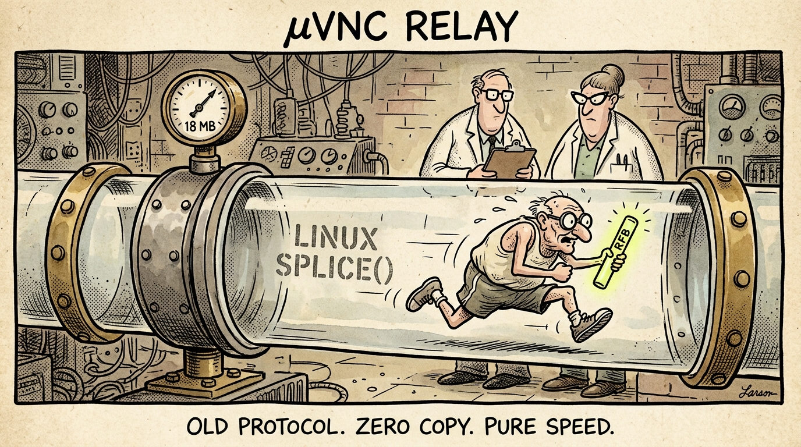

<p align="center">
  
</p>

# μVNC Relay (`microvnc-relay`)

An ultra-lightweight TCP relay, UltraVNC repeater, and visual management hub with real-time bandwidth metering and two-hop latency tracking. Built in pure Go (`CGO_ENABLED=0`) for resource-constrained edge hardware like the **Raspberry Pi 2 (`armv7l`)**, 32-bit Armbian TV boxes, ARM64 boards, and low-spec VPS instances.

> [!NOTE]
> **Project Status: Alpha (`v0.1.0-alpha`) & Active Development**  
> `microvnc-relay` is in active development. Core stream forwarding, Mode 1/2 proxying, and WebUI telemetry are fully functional and empirically stress-tested on physical Raspberry Pi 2 hardware. APIs and configuration options may evolve. Feedback and contributions are welcome.

---

## Why I Built This & Why VNC in 2026?

People often ask: *"Why build a VNC relay in 2026 when modern remote desktop tools like RDP and RustDesk exist?"*

The short answer comes down to **real-world production reliability on edge devices**:

1. **The Windows UAC Blackout Problem**:  
   If you have ever used RustDesk, AnyDesk, or TeamViewer to manage a remote Windows machine, you know the frustration: the moment an administrative **User Account Control (UAC)** prompt appears, or when the screen locks, the remote stream freezes or goes black. You are locked out unless someone physically clicks "Yes". VNC running as a system service hooks directly into the Windows Secure Desktop / Winlogon console—it captures UAC elevation dialogs reliably without dropping the session.
2. **RDP's Complexity & Session Locking**:  
   RDP requires Windows Pro/Enterprise licenses (blocked on Windows Home). More annoyingly, RDP forcibly locks the local physical monitor and creates a detached virtual session. When network links flutter, RDP frequently gets stuck in buggy "ghost" sessions or driver blackouts. On Linux, configuring `xrdp` alongside desktop display managers is notoriously brittle.
3. **Instant, Stateless Reconnection**:  
   VNC directly mirrors the physical console framebuffer. If your Wi-Fi or 4G connection drops, reconnecting takes one second and immediately displays the exact screen state without resetting the display driver or spawning a new session.
4. **Why Cloud Hypervisors (Proxmox, Hetzner, KVM) Still Use VNC**:  
   Cloud and VPS providers exclusively use VNC/noVNC for their emergency rescue consoles because it is agentless and works at the hypervisor level. It stays operational during BIOS boot, GRUB menus, kernel panics, BitLocker prompts, and Windows BSODs—scenarios where RDP and RustDesk daemons cannot even start.

### Protocol Comparison: Real-World Operational Trade-offs

| Protocol | Strengths (Pros) | Operational Gotchas (Cons) | Best Fit |
|---|---|---|---|
| **VNC (RFB)**<br>*(via μVNC Relay)* | • **Rock-solid UAC support**: Captures Windows elevation & lock screens without blacking out.<br>• **Instant reconnect**: Directly mirrors physical console; zero "ghost" session bugs.<br>• **Out-of-band reliability**: Works agentless through crashes & bootloaders.<br>• **Ultra-lean**: Runs in < 10MB RAM with zero CPU-intensive video encoding. | • Higher bandwidth on heavy motion (dirty pixel rectangles vs video encoding).<br>• No native audio redirection. | **Unattended server administration, IoT/edge devices, home labs, rescue console** |
| **RDP** | • Very low bandwidth.<br>• Native audio & drive redirection.<br>• Smooth desktop rendering. | • **Licensing & setup**: Blocked on Windows Home.<br>• **Kicks out local screen**: Locks physical console.<br>• Buggy disconnects (orphaned ghost sessions). | **Corporate office workstations, terminal servers** |
| **RustDesk / AnyDesk** | • Smooth high-FPS video streaming (H.264/VP9).<br>• Built-in P2P rendezvous NAT traversal. | • **UAC blackouts**: Admin prompts freeze video unless running as elevated service.<br>• High CPU load on low-power SBCs (software video encoding).<br>• Fragile WebRTC renegotiation on flaky links. | **Ad-hoc helpdesk support, media/video streaming** |

---

## The Role of μVNC Relay: Modernizing VNC Without the Bloat

Raw VNC has great reliability, but historically suffered from three fatal flaws:
- **No NAT Traversal**: Machines behind firewalls cannot be reached without dangerous router port-forwarding.
- **Insecure Cleartext Transport**: Exposing port 5900 to the public internet is a major security risk.
- **No Central Management**: Managing multiple machines meant remembering individual IPs with zero visibility into link quality or active connections.

**`microvnc-relay` solves all three by acting as an ultra-lightweight zero-trust hub:**

```
 [Remote Viewer] ──(WireGuard / NetBird)──► [ μVNC Relay Hub ] ──(Local LAN / Mode 2 ID)──► [Target Machines]
 (TigerVNC or                              (Raspberry Pi / VPS)                             • Windows (UAC Safe)
  noVNC Browser)                            • < 10MB Process RSS                            • Linux (x11vnc)
                                            • 1Hz Telemetry & Meters                        • Hypervisors (QEMU/KVM)
                                            • Hop 1 & Hop 2 RTT                             • Headless SBCs
```

- **Zero Open Router Ports**: Designed to bind exclusively to private mesh networks like **NetBird** (WireGuard overlay `100.64.0.0/10`). All legacy VNC traffic is wrapped inside kernel-level ChaCha20-Poly1305 encryption.
- **Mode 2 Reverse Dial-Out**: Remote machines behind strict NAT dial out to relay port `:5500` with an ID token (`vncserver -connect <relay>:5500 -id 1234`). Viewers connect to port `:5901` with the matching ID, and the relay splices them together.
- **Mode 1 Generic TCP Port Forwarding**: Maps dedicated virtual ports (e.g. `:5910` $\to$ `192.168.1.50:5900`). Because Mode 1 is transparent zero-copy streaming, it works for **any raw TCP protocol** (VNC `:5900`, RDP `:3389/tcp`, SSH `:22`, HTTP `:80`).
- **Two-Hop Latency Engine**:
  - *Hop 1 (Client ↔ Relay)*: Microsecond RTT read directly from Linux kernel `TCP_INFO`.
  - *Hop 2 (Relay ↔ Target)*: Non-intrusive active TCP SYN handshake probes (~1.8ms).
- **Embedded WebUI & noVNC**: Self-contained dark-mode management dashboard (< 12KB vanilla JS/CSS) with live 1Hz WebSocket telemetry and optional in-browser HTML5 remote control.

---

## Full-Stack Deployment Footprint: How We Compare

Many users compare tools based solely on binary size, but in production, what matters is the **entire server stack footprint** (including runtime, database, and background agents):

| Self-Hosted Solution & Components | Gateway / Server Stack RAM | Target Node Client RAM | Database Required? | Disk Footprint | 256MB–512MB SBC Viable? |
|---|---|---|---|---|---|
| **μVNC Relay + NetBird**<br>• `microvnc-relay` (Static Go binary)<br>• NetBird client (WireGuard overlay)<br>• Optional Docker container | **~25 MB – 35 MB total**<br>*(~9.7 MB relay + ~18 MB NetBird)* | **~12 MB – 15 MB**<br>*(Native `x11vnc` / `winvnc` service)* | **❌ None**<br>*(0 disk writes; in-memory ring buffers)* | **< 50 MB**<br>*(Two static Go binaries)* | **✅ Excellent**<br>*(Runs 24/7 on Pi 2 / Orange Pi Zero with 800MB+ free)* |
| **RustDesk Server Stack**<br>• `hbbs` (ID / Rendezvous server)<br>• `hbbr` (Relay server)<br>• SQLite database | **~45 MB – 70 MB** | **~100 MB – 250 MB**<br>*(Desktop video capture & encoder)* | **⚠️ SQLite** | ~120 MB | **⚠️ Marginal**<br>*(Server runs, but software video encoding chokes SBC targets)* |
| **MeshCentral Stack**<br>• Node.js runtime daemon<br>• MongoDB or NeDB | **~250 MB – 450 MB** | ~40 MB – 80 MB<br>*(MeshAgent)* | **⚠️ MongoDB / NeDB** | ~400 MB – 800 MB | **❌ Incompatible**<br>*(Node.js + Mongo exceeds 512MB budget)* |
| **Apache Guacamole Full Stack**<br>• `guacd` (C proxy daemon)<br>• Apache Tomcat (Java web app)<br>• PostgreSQL / MySQL database | **~500 MB – 1.2 GB+**<br>*(JVM heap + DB + guacd)* | **~12 MB – 15 MB**<br>*(Standard VNC server)* | **⚠️ PostgreSQL / MySQL** | **~1.5 GB – 3 GB**<br>*(Heavy JRE & DB storage)* | **❌ Impossible**<br>*(Immediate OOM thrashing / crash on edge hardware)* |

---

## Real-World Hardware Benchmarks: Raspberry Pi 2 (`armv7l`)

These measurements were captured directly on physical hardware (Raspberry Pi 2 Model B, quad-core Cortex-A7 @ 900MHz, Debian 12 Bookworm, NetBird mesh overlay):

| Metric | Measured Physical Value | Target Budget | Status |
|---|---|---|---|
| **Idle Process RSS** | **8.66 MB** | < 15.0 MB | **PASS** (Baseline idle) |
| **Active Load RSS (2 Streams)** | **8.80 MB** (8,800 kB) | < 35.0 MB | **PASS** (< 26% of budget) |
| **Active Load RSS (5 Streams)** | **8.88 MB** (8,880 kB) | < 35.0 MB | **PASS** (< 26% of budget) |
| **Active Load RSS (10 Streams)** | **8.97 MB** (8,976 kB) | < 35.0 MB | **PASS** (+316 kB delta over 10 streams) |
| **Dynamic Heap/Stack (`RssAnon`)** | **2.61 MB** (2,680 kB) | Bounded via `GOMEMLIMIT` | Zero uncontrolled growth |
| **Clean Binary Code (`RssFile`)** | **6.15 MB** (6,296 kB) | Clean file-backed pages | Pure Go static executable |
| **Host System Free RAM** | **849 MB – 850 MB** free | > 500 MB safe margin | **PASS** (Zero OOM pressure) |
| **Teardown & FD Reclamation** | Returned to **11 FDs** post-test | Zero socket leak | **PASS** (Zero zombie sessions) |
| **Hop 2 TCP Dial RTT** | **1.61 ms – 3.21 ms** | Real-time SYN inspection | Microsecond precision |
| **Disk & Swap Activity** | **0 bytes** (Zero disk writes) | Zero flash wear | **PASS** (MicroSD wearout protected) |

### Resolution Independence: Why 1080p and 4K Do Not Inflate RAM

Unlike gateways like Apache Guacamole that decode video frames into an uncompressed internal bitmap ($1920 \times 1080 \times 4\text{ bytes} \approx 8.3\text{ MB}$ per screen in memory):
- **Zero Framebuffer Caching**: `microvnc-relay` is a transparent byte-stream pipe. It never decodes RFB dirty rectangles or holds full screen frames in memory.
- **Fixed Bounded Chunking**: All streaming transfers pass through a reusable `sync.Pool` of **32 KB buffers** (or kernel `splice(2)` in unmetered mode). Each active connection holds at most ~64 KB of transient TCP data in flight regardless of whether the remote desktop resolution is $640 \times 480$, $1080\text{p}$, or $4\text{K}$.
- **What Scales with Resolution**: Screen resolution and graphical motion scale **network bandwidth** (e.g., 2–15 Mbps per active 1080p stream) and **CPU packet handling** (~10%–25% CPU on a 900MHz Cortex-A7 under heavy redraws), while process RAM remains bounded **under 12 MB**.

---

## Configuration & NetBird Recipe

`microvnc-relay` separates static daemon settings (`config.yaml`) from dynamic target machines (`targets.yaml`) so adding or editing targets via the WebUI or CLI never touches your bind addresses or security policies:

```yaml
# /etc/microvnc-relay/config.yaml
server:
  web_bind: "100.64.0.1:8080"  # Bind to your NetBird wt0 interface
  vnc_bind: "100.64.0.1"       # Listeners accessible only via WireGuard mesh
  mode2_reverse_port: 5500     # Reverse VNC target machines connect here
  mode2_viewer_port: 5901      # Viewers connect here specifying matching ID
  targets_file: "targets.yaml" # Dedicated target list (auto-detected alongside config.yaml)

security:
  auth_enabled: true           # First run requires the one-time token from journal/docker logs
  session_timeout_minutes: 1440

access_control:
  enabled: true
  allowed_subnets:
    - "100.64.0.0/10"          # NetBird overlay subnet only
    - "127.0.0.1/32"
```

### First-Run Setup (Token-Only)

A fresh install has **no default credentials**. On first start the relay prints a one-time setup token:

```bash
sudo journalctl -u microvnc-relay -n 50 | grep -i "setup token"
# Docker:
docker logs <container> 2>&1 | grep -i "setup token"
```

Paste that token into the WebUI setup form along with the new administrator username and password. The token is held in memory only, is never served over HTTP, and is invalidated as soon as setup completes.

Password reset is explicit:

```bash
sudo systemctl stop microvnc-relay
sudo rm /etc/microvnc-relay/auth.json
sudo systemctl start microvnc-relay
# read the newly printed setup token and complete setup again
```

```yaml
# /etc/microvnc-relay/targets.yaml
devices:
  - id: "workbench-pi"
    name: "Workbench Pi 2"
    host: "192.168.1.50"
    port: 5900                 # Can be 5900 (VNC), 3389 (RDP), 22 (SSH)
    virtual_port: 5910         # Connect via 100.64.0.1:5910
    mode2_id: 1234
    enabled: true
```

### Hot-Reload vs. Restart
- **Adding/Editing Devices**: Can be done live in the WebUI (with instant port-conflict detection and status toasts) or by editing `targets.yaml` and running `microvnc-relay --reload` (or `sudo systemctl reload microvnc-relay`). Active connections on other ports will **not** be dropped.
- **System Settings** (`server.*`, `features.*`, `security.*`): Require `sudo systemctl restart microvnc-relay`.
- **Config Validation**: Test your configuration and check for port collisions before restarting with `microvnc-relay -c config.yaml --check-config` (exit code `0` = valid).

---

## Explicit Non-Goals (Delegate Outward)

To ensure this daemon remains under 35MB RSS and never wears out MicroSD flash storage:
- **No UDP Relay**: TCP-only byte streaming. UDP / WireGuard traffic stays on NetBird natively.
- **No Load Balancing**: Strictly 1 virtual port $\to$ 1 target machine. Use HAProxy upstream if you need load balancing.
- **No TLS Termination**: Transport encryption is offloaded to NetBird's kernel-level ChaCha20-Poly1305.

---

## Hardware Targets

| Platform | Architecture | System RAM | Process Budget | Measured RSS |
|---|---|---|---|---|
| **Raspberry Pi 1 (A/B/B+) & Pi Zero / Zero W** | ARMv6 (`armv6l` / `armhf`, `GOARM=6`) | 256MB – 512MB | < 25 MB | **~8.5 MB** |
| **Raspberry Pi 2 / Orange Pi Zero LTS** | ARMv7 (`armv7l`, `GOARM=7`) | 256MB – 512MB | < 30 MB | **~8.9 MB** |
| **Armbian TV Boxes** | ARMv7 / ARM64 | 512MB – 1GB | < 35 MB | **~9.5 MB** |
| **Raspberry Pi 3/4/5** | ARM64 (`aarch64`) | 1GB – 8GB | < 35 MB | **~9.7 MB** |
| **Linux Servers & Workstations** | x86-64 (`amd64`) | 1GB+ | < 40 MB | **~10.5 MB** |

---

## 🔒 Security Disclaimer & Limitation of Liability

```
THE SOFTWARE IS PROVIDED "AS IS", WITHOUT WARRANTY OF ANY KIND, EXPRESS OR
IMPLIED, INCLUDING BUT NOT LIMITED TO THE WARRANTIES OF MERCHANTABILITY,
FITNESS FOR A PARTICULAR PURPOSE, AND NONINFRINGEMENT. IN NO EVENT SHALL
THE AUTHORS BE LIABLE FOR ANY CLAIM, DAMAGES, OR OTHER LIABILITY ARISING
FROM, OUT OF OR IN CONNECTION WITH THE SOFTWARE.
```

- **User Responsibility**: You are solely responsible for access controls, interface binding, and firewall rules.
- **No Public WAN Exposure**: Never expose raw VNC ports or the WebUI directly to the public internet without an encrypted overlay (NetBird, WireGuard, Tailscale) or reverse proxy TLS.
- **Limitation of Liability**: The authors and contributors accept no liability for security incidents, data loss, downtime, or hardware damage.

---

## License

This project is licensed under the **Apache License, Version 2.0**. See the [LICENSE](LICENSE) file for details.
